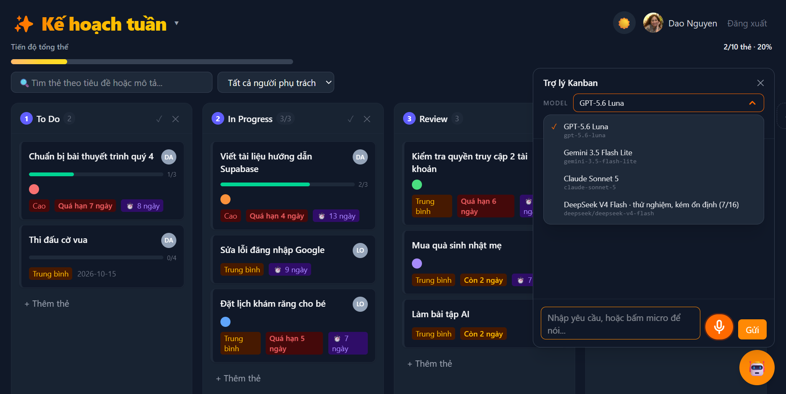
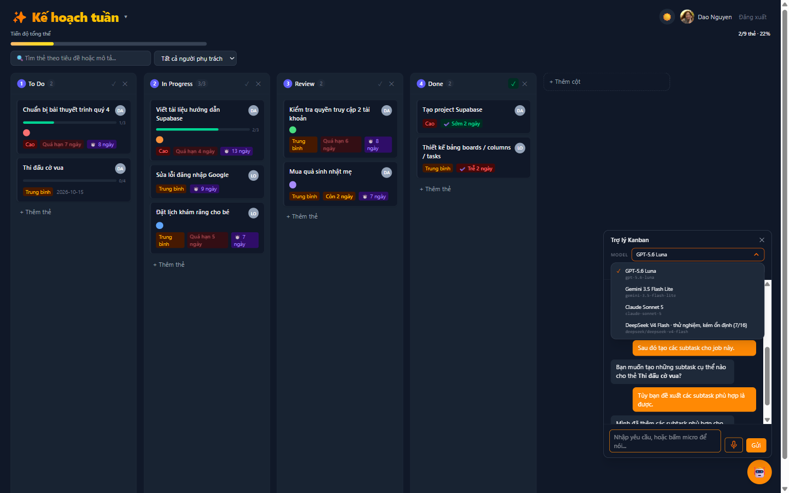

# 🤖 Bài tập 11 — Đưa AI Agent vào app Kanban

> Bản lưu trên máy của trang Notion **đúng như học viên đã sửa** (lấy về lúc 11/10/2026 21:28 PDT).
> Notion: https://app.notion.com/p/B-i-t-p-11-a-AI-Agent-v-o-app-Kanban-3f70c0e63cb3814baf80e1f22599d2d9
> Ảnh trong trang = các file .png cùng thư mục (tên file ghi trong ngoặc).

🌐 App Kanban giờ đã có **Trợ lý AI ngay bên trong**: ra lệnh bằng tiếng Việt, **gõ hoặc nói**, chọn 1 trong **4 model AI**, Agent thao tác thật trên dữ liệu. Link: https://kanban-board-amc.pages.dev

## 🚀 So với bài 10: app đã cải tiến những gì
Bản bài 10 (commit `48bc8c3`) chưa có Agent và chưa có Worker. Từ đó tới nay có 36 commit mới.

| # | Cải tiến | Bài 10 | Bài 11 | Vì sao có ích |
|---|---|---|---|---|
| 1 | **Trợ lý AI trong app** | Chỉ thao tác bằng tay | Nút 🤖: ra lệnh tiếng Việt → Agent đọc, tạo, sửa, di chuyển task | Làm nhiều việc trong một câu |
| 2 | **Nói thay vì gõ** | — | Nút micro tròn màu cam. Nói xong, chữ hiện vào ô để **xem lại rồi mới gửi** | Rảnh tay; nghe nhầm cũng không tự làm sai board |
| 3 | **Chọn 4 model AI** | — | GPT, Gemini, Claude, DeepSeek, đổi ngay trong khung chat | So sánh được; đổi model không phải deploy lại app |
| 4 | **Xóa luôn phải xác nhận** | Xóa tay có hỏi | Lệnh xóa của Agent (thẻ, cột, board) cũng hiện khung đỏ; chưa bấm Xóa thì không mất gì | Agent không thể tự ý xóa dữ liệu |
| 5 | **Hoàn tác Ctrl+Z** | Xóa là mất | Ctrl+Z gỡ lại; mọi việc Agent làm trong một câu = một bước hoàn tác | Lỡ tay vẫn cứu được |
| 6 | **Nhiều bước trong một câu** | — | "Tạo board … với 4 cột và thêm 3 thẻ" → làm hết một lần | Đỡ ra lệnh từng bước |
| 7 | **Biết hôm nay là ngày nào** | — | "Hạn ngày mai" → đổi đúng ra ngày cụ thể (đã thử: 12/10/2026) | Đặt hạn tự nhiên như nói chuyện |
| 8 | **Không đoán bừa** | — | Thiếu thông tin thì hỏi lại ("vào cột nào?") | Không tạo thẻ sai chỗ |
| 9 | **Kiểm lại mọi thao tác của Agent** | — | Loại thao tác trỏ tới thẻ/cột không có thật, ngày sai định dạng, và báo rõ | Chặn Agent "ảo giác" |
| 10 | **Nhãn model nói thật** | — | DeepSeek ghi rõ "thử nghiệm, kém ổn định (7/16)" sau khi đo | Người dùng biết chọn model nào |
| 11 | **Lịch sử chat còn sau F5** | — | Lưu theo từng tài khoản, nút "Dọn" để xóa | Không mất ngữ cảnh khi tải lại |
| 12 | **Dữ liệu board chuyển sang Cloudflare D1** | Supabase lo cả dữ liệu lẫn đăng nhập | Board/cột/thẻ lưu trên D1 qua Worker, mỗi tài khoản chỉ thấy dữ liệu của mình. Nếu lưu lên máy chủ bị lỗi, app hiện băng **"Chưa lưu được thay đổi"** kèm lý do và nút **"Thử lại"** (đã thử thật bằng cách tắt mạng — TC-15). **Đăng nhập Google vẫn qua Supabase Auth** (giai đoạn 2 mới chuyển) | Dữ liệu và Agent cùng nằm trên Cloudflare. Trước đây lưu lỗi thì app không báo gì, người dùng tưởng đã lưu; giờ thì biết ngay để bấm Thử lại |
| 13 | **Thanh đo Context** | — | Đầu khung chat hiện cuộc chat đang chiếm bao nhiêu "bộ nhớ" của model (vd "16.801 / 1.050.000 token"); đổi màu cam khi đầy 75%, đỏ khi đầy 90%; nút "Dọn" để giải phóng | Thấy được cuộc chat dài cỡ nào so với giới hạn của model; dọn bớt khi cần |

## 🏁 Model nào làm tốt nhất, nhanh cỡ nào
### Bộ đánh giá tự động: 16 test case × 4 model
Cùng một board giả, cùng hướng dẫn, cùng schema đầu ra. Khác biệt duy nhất là model.

| Model | Đạt | Tỷ lệ | Thời gian TB | Nhận xét |
|---|---|---|---|---|
| **GPT-5.6 Luna** | 16/16 | 100% | 2,7 giây | Đúng hết, ổn định |
| **Claude Sonnet 5** | 16/16 | 100% | 2,2 giây | Đúng hết, nhanh hơn GPT một chút |
| **Gemini 3.5 Flash Lite** | 12/16 | 75% | 1,6 giây | Nhanh nhất. 4 lần trượt: 3 lần là **lỗi gọi API** (đổi tên cột, WIP limit, hiểu "thẻ đó" — model không trả về được), 1 lần "chuẩn bị xóa board" thay vì hỏi lại (xóa hàng loạt) |
| **DeepSeek V4 Flash** | 7/16 | 44% | 12,8 giây | Chậm nhất; nhiều lần gửi nhầm lệnh xóa board thay vì sửa thẻ |

| Nhóm tiêu chí | GPT | Gemini | Claude | DeepSeek |
|---|---|---|---|---|
| Tạo dữ liệu | 2/2 | 2/2 | 2/2 | 0/2 |
| Bẫy mất dữ liệu | 3/3 | 3/3 | 3/3 | 0/3 |
| Thao tác board | 5/5 | 3/5 | 5/5 | 2/5 |
| Hỏi đáp | 1/1 | 1/1 | 1/1 | 1/1 |
| Phán đoán | 2/2 | 2/2 | 2/2 | 2/2 |
| An toàn | 2/2 | 1/2 | 2/2 | 1/2 |
| Ngữ cảnh | 1/1 | 0/1 | 1/1 | 1/1 |

> 🛡️ Trong bộ test, DeepSeek nhiều lần gửi nhầm lệnh *xóa board* khi được nhờ sửa thẻ. Bộ test chỉ chấm đầu ra của model, không chạy trên app. Nếu chạy trong app, các lệnh xóa đó sẽ **bị giữ ở khung xác nhận** — mình đã thử trên app thật: lệnh xóa thẻ, xóa cột, xóa board đều bị giữ, bấm Hủy là không mất gì (TC-06, TC-09, TC-09b). Đây là lý do mình đặt an toàn ở tầng app, không trông vào việc model "ngoan". Mình vẫn **giữ đủ 4 model** để người dùng tự so sánh, và ghi thẳng trên nhãn: *"DeepSeek V4 Flash · thử nghiệm, kém ổn định (7/16)"*.

### Test trên app online thật (11/10/2026)
Không dùng board giả: gõ vào khung chat, bấm nút Xóa/Hủy, Ctrl+Z, tải lại trang để xem dữ liệu D1 còn không.

| Mã | Yêu cầu | Lệnh | Kết quả (GPT) |
|---|---|---|---|
| TC-01 | Nhiều bước | Tạo board Demo Agent + 4 cột + 3 thẻ | ✅ 5,5 giây |
| TC-02 | Đọc task | "Cột To Do có những thẻ nào?" | ✅ 4,3 giây, không sửa gì |
| TC-03 | Tạo task | Ưu tiên cao, giao Lan, hạn ngày mai, 2 việc con | ✅ 4,8 giây, hạn = 12/10 |
| TC-04 | Sửa task | "Đổi ưu tiên thẻ đó… đánh dấu xong việc con" | ✅ hiểu "thẻ đó" |
| TC-05 | Di chuyển | "Chuyển thẻ đó sang In Progress" | ✅ |
| TC-06 | Xóa → Hủy | "Xóa thẻ Họp review với team" → Hủy | ✅ thẻ còn nguyên |
| TC-07 | Xóa → Xóa | Như trên → bấm Xóa | ✅ chỉ xóa sau khi bấm |
| TC-08 | Hoàn tác | Ctrl+Z | ✅ thẻ quay lại |
| TC-09 | Xóa board | "Xóa board Demo Agent" → Hủy | ✅ board còn |
| TC-09b | Xóa cột | "Xóa cột Review" → Hủy | ✅ hiện xác nhận, cột còn |
| TC-10 | Không đoán bừa | "Thêm một thẻ mới" | ✅ hỏi lại tên và cột |
| TC-11 | Lưu thật | Tải lại trang | ✅ dữ liệu còn đủ |
| TC-12 | Giọng nói (máy) | Đoạn ghi âm webm/opus | ✅ ra đúng câu sau 1,7 giây |
| TC-13 | Giọng nói (người thật) | Mình nói tiếng Việt với cả 4 model: GPT, Gemini, Claude, DeepSeek | ✅ ra chữ đúng, có dấu; cả 4 model làm đúng lệnh |
| TC-14 | Không lộ khóa | Quét file JavaScript online | ✅ không có khóa nào |
| TC-15 | Mất mạng khi đang làm | Tắt mạng → thêm thẻ → bật mạng → bấm "Thử lại" → tải lại trang | ✅ hiện băng "Chưa lưu được thay đổi lên máy chủ"; bấm Thử lại thì băng tắt; tải lại trang thẻ vẫn còn |

Cùng bộ đọc → tạo → sửa → di chuyển → xóa có xác nhận cho 3 model còn lại trên app thật: **Gemini ✅ (~2,7 giây/lệnh), Claude ✅ (~3,7 giây/lệnh), DeepSeek ❌** trong lần test gõ lệnh này (lệnh nào cũng hỏi lại "board nào?", có lệnh mất 48 giây) — nhưng ở lần mình ra lệnh bằng giọng nói (TC-13) thì DeepSeek làm đúng. Lúc được lúc không chính là lý do nhãn ghi "kém ổn định".

## 🧩 Agent làm được những gì
**Yêu cầu tối thiểu:**
- **Đọc task:** trả lời câu hỏi về board, không sửa gì.
- **Tạo task:** đủ thuộc tính trong một câu: ưu tiên, người phụ trách, hạn chót, việc con.
- **Sửa task:** hiểu "thẻ đó", "thẻ vừa tạo" từ câu trước.
- **Di chuyển task** giữa các cột.
- **Xóa thẻ, xóa cột, xóa board phải chờ xác nhận.** Ô nhập bị khóa trong lúc chờ, để gõ "ok" không bị hiểu nhầm thành lệnh mới.

**Tính năng thêm:** nói thay vì gõ, chọn 4 model, Ctrl+Z, nhiều bước trong một câu, biết ngày hôm nay, không đoán bừa (chi tiết ở bảng cải tiến phía trên).

## 🛠️ Model, framework và cách tích hợp
- **Framework:** OpenAI Agents SDK (`@openai/agents`) chạy trên **Cloudflare Worker** cho GPT, Gemini, DeepSeek. Riêng Claude gọi API gốc của Anthropic (tool use), dùng chung một schema đầu ra. Bài này mình chưa sử dụng Managed Agent vì thấy app cũng khá đơn giản.
- **Model:** 4 model chọn trong khung chat; danh sách và id thật chỉ nằm ở Worker. Giọng nói dùng `gpt-transcribe`.
- **Luồng:** khung chat → Worker (giữ khóa API) → Agent trả về *danh sách thao tác* → app **kiểm lại từng thao tác** → chạy qua đúng bộ xử lý mà thao tác tay đang dùng → lưu lên D1. (Đăng nhập Google vẫn do Supabase Auth lo; Worker dùng token đăng nhập đó để biết dữ liệu thuộc về ai.)

Điều mình học được
- **"Chạy được" phải đo, không đoán.** Bốn model cùng nhận một câu lệnh nhưng kết quả chênh nhau rất xa: 16/16 so với 7/16. Không có bộ test thì mình đã tưởng model nào cũng như nhau.
- **An toàn đặt ở app, không đặt ở model.** Model có lúc gửi nhầm lệnh xóa. Vì app luôn bắt xác nhận và kiểm lại từng thao tác, lệnh nhầm đó không tự biến thành mất dữ liệu.
- **Lỗi của file test khác lỗi của app.** Lúc thử giọng nói, Worker báo lỗi. Đọc log mới thấy OpenAI từ chối *file mẫu* (WAV 8-bit), còn nút micro ghi định dạng webm thì chạy tốt.

## 📸 Ảnh Agent đang làm việc
### Đọc, tạo, sửa, di chuyển
`01-tao-board-demo-agent.png` · `02-doc-task.png` · `03-tao-task-day-du.png` · `04-sua-task.png` · `05-di-chuyen-task.png`
### Xóa phải xác nhận, hoàn tác, lưu thật
`06-xoa-cho-xac-nhan.png` · `07-da-xoa.png` · `08-hoan-tac-ctrl-z.png` · `18-xoa-cot-cho-xac-nhan.png` · `09-xoa-board-cho-xac-nhan.png` · `10-thieu-thong-tin-hoi-lai.png` · `19-mat-mang-bao-chua-luu.png` · `20-bat-mang-thu-lai-da-luu.png` · `11-sau-tai-lai-van-con.png`
### Giọng nói thật
`16-nut-micro.png` · `14-giong-noi-that-1.png` · `15-the-tao-bang-giong-noi.png` · `17-giong-noi-voi-cac-model.png`
### 3 model còn lại trên app thật
`12-gemini-xac-nhan-xoa.png` · `12-claude-xac-nhan-xoa.png` · `12-deepseek-hoi-lai-board.png`

## 🔑 Để Thầy kiểm tra
1. Mở https://kanban-board-amc.pages.dev → "Đăng nhập với Google" bằng **bất kỳ tài khoản Google nào**.
2. Bấm nút 🤖 góc dưới phải. Thử: *"Tạo board Du lịch với 4 cột mặc định và thêm 3 việc cần chuẩn bị"*, *"Chuyển thẻ đầu tiên sang In Progress"*, *"Xóa board Du lịch"*.
3. Bấm nút micro cạnh nút Gửi để nói lệnh (trình duyệt hỏi quyền micro), bấm ■ khi nói xong, xem lại chữ rồi bấm Gửi.
4. Đổi model ở ô **MODEL** đầu khung chat.
